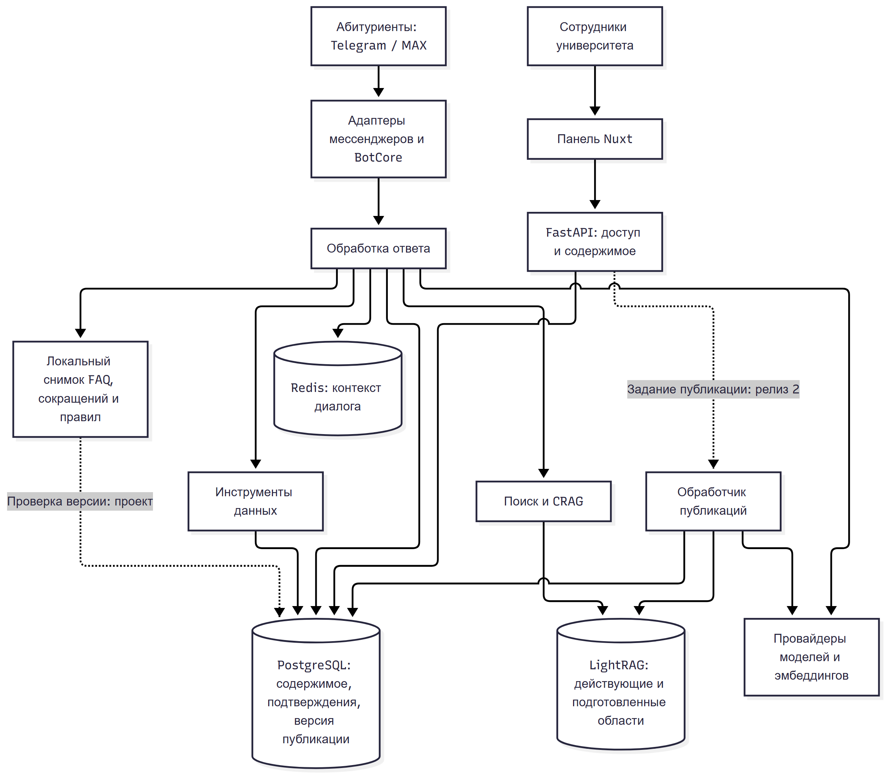
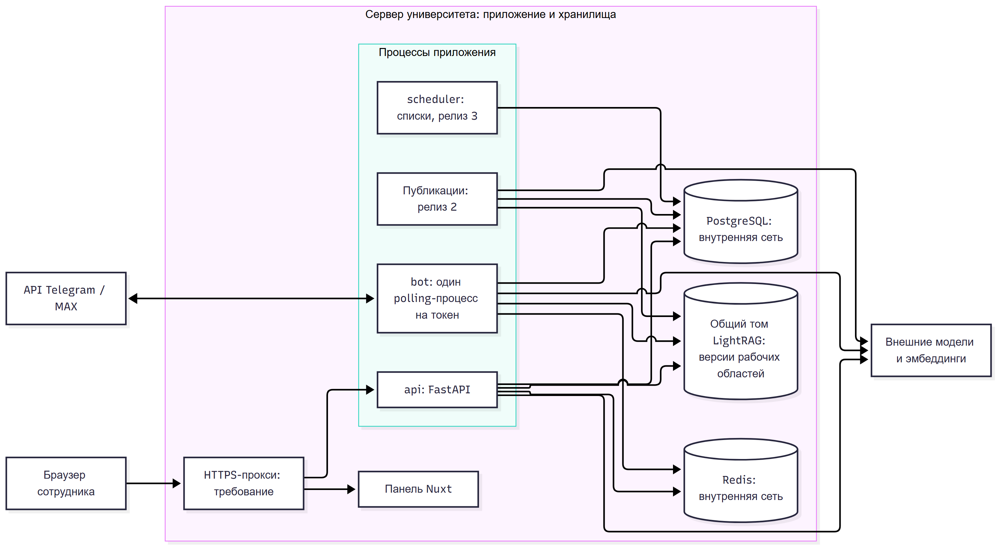
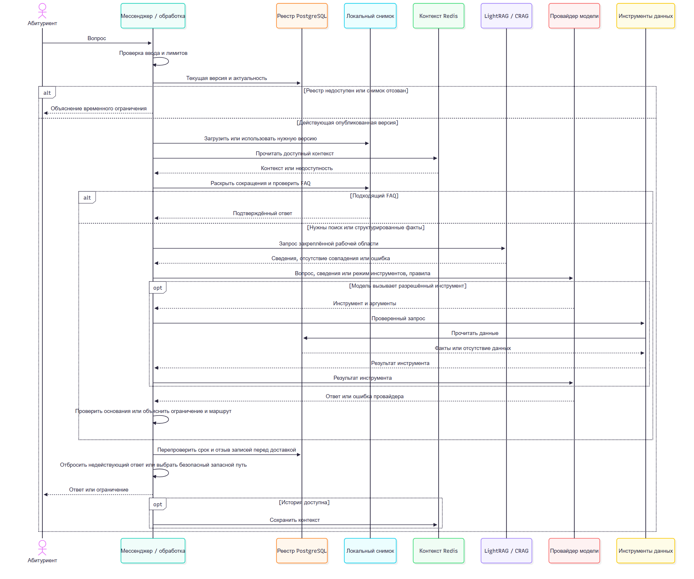

# Проверенные схемы SAD

Отрисовка и просмотр выполнены 14 ноября 2026 года. Исходники `.mmd`
точно соответствуют трём Mermaid-блокам подготовленного SAD. Это изображения
для ревью. В Wiki сохраняются редактируемые Mermaid-схемы.

## Компоненты

[SVG для увеличения](components.svg) · [Исходник](components.mmd)



## Развёртывание

Направление изменено с TB на LR, чтобы стрелка не пересекала заголовок группы.
Узлы, подписи и связи сохранены.

[SVG для увеличения](deployment.svg) · [Исходник](deployment.mmd)



## Путь вопроса до ответа

[SVG для увеличения](question-answer.svg) · [Исходник](question-answer.mmd)



## Повторная отрисовка

Использованы `@mermaid-js/mermaid-cli@12.2.0`, Mermaid 12.3.0 и Microsoft Edge
157.0.4341.46. Рендерер установлен в отдельный каталог, параметры браузера
передаются через локальный JSON с `executablePath`. Пример из каталога схем:

```sh
mmdc -i components.mmd -o components.png -p /path/to/puppeteer.json --size 2400
mmdc -i components.mmd -o components.svg -p /path/to/puppeteer.json --size 2400 --no-font-embed
```

Для `question-answer` используется размер 2400, для `deployment` - 3000.
Состав проверки и контрольные суммы находятся в `render-manifest.json`.
