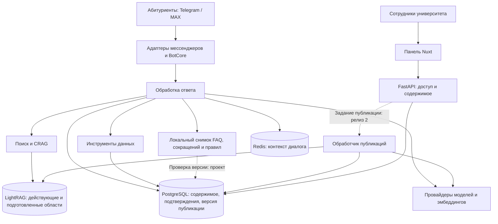
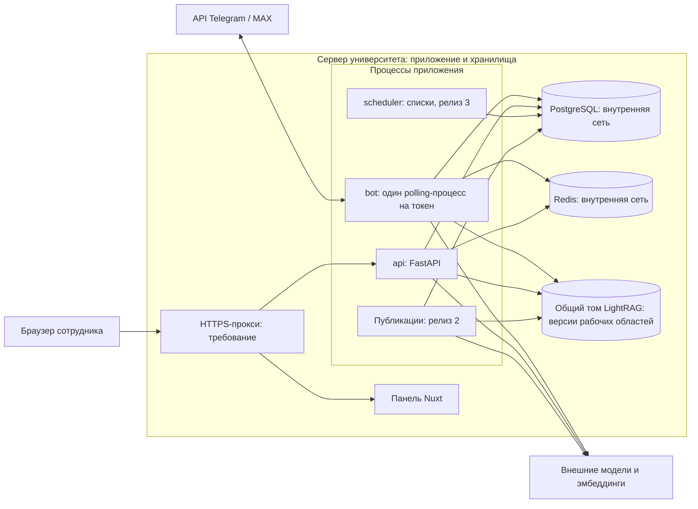
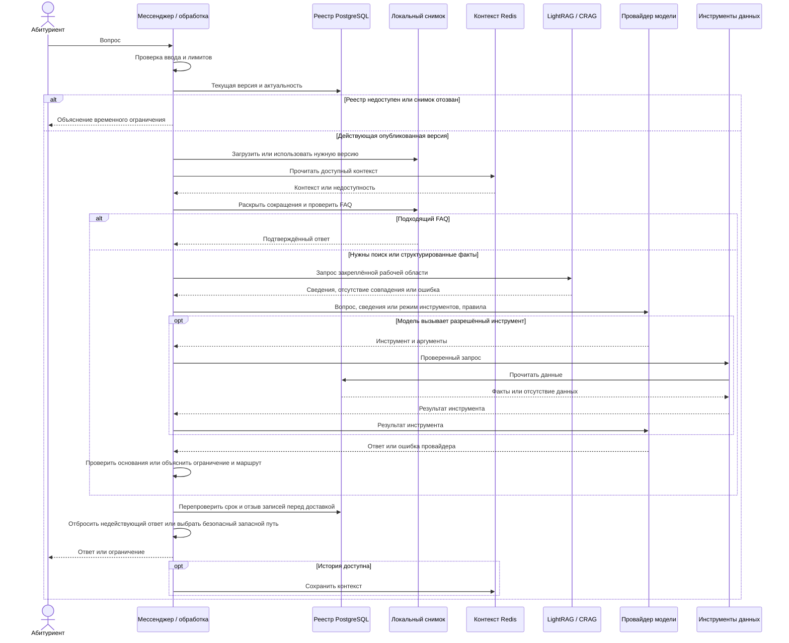

# Архитектура Abitur Bot - SAD

## 0. Авторы и ответственность

- **Марат Тимофеев** - техническая архитектура и интеграционные решения.
- **Максим Вылегжанин** - развёртывание, инфраструктура, интеграция Telegram/MAX.
- **Михаил Дешин** - backend, API и доступ к PostgreSQL.
- **Александр Ермаков** - подготовка знаний, качество данных и ответов.

## 1. Цели и ограничения

Документ на 2026–2027 учебный год следует [Vision](Vision),
[SRS](Software-Requirements-Specification), [рискам](Risk-table) и
[плану релиза](План-релиза). Релиз 1 обслуживает Telegram/MAX и панель сотрудников.
Релиз 2 добавляет полный процесс содержимого, эксплуатацию и историческое
сравнение баллов. Виджет nsu.ru требует согласования с владельцами сайта.

**Основания проверки.** Решения по публикации и исходное состояние индексатора,
кэшей и Compose проверены 31.10.2026 по backend
[`ba4f931`](https://github.com/nsu-abitur-bot/abitur-bot/tree/ba4f9315d4d2ef4da2a2bb45c3983a953cc4446a).
01.11.2026 по [`c608c31`](https://github.com/nsu-abitur-bot/abitur-bot/tree/c608c31e7e1bd73b6c4eab47d8b81c745621b2b6)
уточнены регистрация, загрузка URL, публикация образа, настройки и 10 сценариев evals.
Инструменты frontend сверены по `ac65b37`. Замечания к отображению evals сохранены
как результат прежнего просмотра `31b5536` от 24.10.2026. Текущий UI целиком
не проверялся. Работа на сервере, восстановление и живое качество здесь не проверялись.

### Проверенные обновления на 13 ноября 2026 года

Backend сверён на `9acb2c7`, frontend - на `8840179`. Проверены профили моделей,
манифесты запуска, инструкции и workflow выкладки. Исторические сведения выше
сохраняют даты и версии своих проверок. Полный повторный аудит приложения
и работающих каналов не проводился.

Принят [отчёт #390](https://github.com/nsu-abitur-bot/abitur-bot/blob/9acb2c7fa4bd83f03660f0d054285a5cb37621b7/docs/reports/390-measurements-2026-11-12.md). Сбор #388 завершён: подтверждено внутри команды 50/50,
экспертно 0/50. Результат исторической конфигурации после ручных решений -
30/50 с базой и 0/50 без неё, три критических случая.

Автодеплой и ручной откат образа приложения реализованы. Откат образа
не возвращает схему БД и содержимое хранилищ. Живые проверки и условия
восстановления перенесены в [#470](https://github.com/nsu-abitur-bot/abitur-bot/issues/470). Полный цикл публикации содержимого
в разделе 4.4 остаётся проектным решением для реализации.

### 1.1 Функциональные требования

- Ответы по источникам о поступлении и первых неделях в Telegram/MAX - релиз 1.
- Процедурные знания от ответственных сотрудников с происхождением, подтверждением и сроком. Проверенные маршруты обращения - релиз 1.
- Исправления через панель с проверкой обоих ботов - релиз 1. Черновики, согласование, версии и откат - релиз 2.
- Источник и статус правил `confirmed`, `observed practice`, `proposed`. Версионируемый реестр в приложении - релиз 2. Подтверждён запрет выбирать программу за пользователя.
- Проверка полного пути ответа, обратная связь, качество и использование - релиз 1.
- Исторические баллы с уточнениями - релиз 2. Виджет - отдельное предложение без согласованного релиза.
- Конкурсные списки по семисимвольному ID и уведомления - релиз 3.
- Авторизация и существующие роли - релиз 1. Права редактора только на содержимое - релиз 2.

### 1.2 Нефункциональные требования

- **Скорость:** NFR-2 - полный доставленный ответ до 30 секунд для 95% запросов, уведомление релиза 3 до 1 часа. NFR-4 требует полного учёта вызовов, токенов и повторов. Пределы следующего пилота описаны на странице лимитов. Постоянный бюджет пока не установлен.
- **Доступность:** 99,0% за полный календарный месяц по каждому каналу, с пробами и правилами расчёта.
- **Восстановление:** NFR-6 - ручное восстановление согласованных SQL/LightRAG-копий в релизе 1. Значения RTO и RPO пока не согласованы, нужны измерения #470. Откат образа приложения уже есть. Перестроение индекса и полный откат содержимого относятся к релизу 2.
- **Нагрузка:** отдельно проверить первый запуск и приёмную кампанию, учитывая общие хранилища и локальное состояние процессов.
- **Развитие:** адаптеры каналов/провайдеров используют общую обработку и правила ответа.
- **Безопасность:** серверные права, контролируемое создание сотрудников, изоляция разговоров и правила персональных данных.
- **Эксплуатация:** ответственный, просмотр ошибок, копии и проверенное ручное восстановление - релиз 1. Автодеплой и откат образа реализованы. Расширенные мониторинг/алерты, минимум два получателя и учения - релиз 2.

### 1.3 Архитектурные цели

- Запустить выбранные темы и базовые исправления в релизе 1, полный процесс - в релизе 2.
- Считать подтверждённые источники основой, а поисковые индексы - восстанавливаемыми производными.
- Отделить обработку ответа от FAQ, поиска, БД и провайдеров. Проверять тот же путь, которым пользуются каналы.
- Доставлять опубликованные изменения всем отвечающим процессам, сообщать о сбоях и обеспечивать восстановление.
- Принимать функции следующих релизов в соответствующих этапах, сохраняя возможность первого запуска вне сезона.

### 1.4 Дополнительные ограничения

- Используются Python/FastAPI/SQLAlchemy/LightRAG и Nuxt. Поиск работает через граф и встроенный векторный индекс LightRAG.
- Темы: поступление, первые действия после зачисления, магистратура и дни открытых дверей. Музей, курсы и отдельные сервисы партнёров вне состава.
- Процедуры подтверждают их владельцы. Для сведений, отсутствующих в публичных документах, команда получает отдельное подтверждение.
- Историческое сравнение не прогнозирует поступление. Точные предупреждения и обязательное предложение платного обучения требуют отдельного согласования.
- FR/NFR и UC сохраняют номера. Заморозка требований релиза 1 - 13.11.2026: числа, проверки, оставшиеся работы, ответственные и сроки. Завершение реализации и запуск датируются отдельно.

## 2. Выбор решений

### 2.1 Замена LLM-провайдеров

**Цель:** менять генерацию, поиск и разбор PDF без переписывания каналов и правил (FR-1, UC-1, NFR-8).

**Варианты:** прямой вызов SDK либо общий интерфейс с адаптерами и профилями.
Выбран общий интерфейс `llm/base.py::BaseLLMProvider`, фабрика `llm/factory.py`
и реализации `llm/providers/`. Провайдеры выбираются параметрами
`LLM_PROVIDER`, `LIGHTRAG_LLM_PROVIDER`, `PDF_PARSER_PROVIDER`, параметры задач -
в `llm/profiles.py`. В схеме экземпляра также отдельно выбираются провайдеры эмбеддингов.

Смена требует проверки качества, инструментов и учёта расходов. Переход на
резервного провайдера отрабатывается как эксплуатационная процедура.

### 2.2 Проверка качества ответа

**Цель:** сохранять проверенные улучшения после правок кода, моделей и содержимого (FR-8, UC-8, NFR-3/NFR-4).

Проверка одного поиска пропускает FAQ, сокращения, инструменты и правила.
Выбран `evals/` вокруг `pipeline.llm_client.ask_local_llm`: YAML v1, ассерты,
необязательный LLM-судья, ограничения параллелизма/ожидания и проверенный базовый
результат. CI выполняет изолированный прогон. Перед запуском проверяются
50 подтверждённых вопросов: минимум 41/45 по документам, 5/5 специальных
сценариев и ни одной критической ошибки. В реестре #388 записаны источник,
проверивший, основание и уровень подтверждения.
Внутреннее и позднейшее экспертное подтверждения хранятся отдельно.

### 2.3 Управление базой знаний

**Цель:** сотрудники исправляют ответы и маршруты через панель (FR-4/FR-5/FR-9, UC-4/UC-5/UC-9).

Существующие формы CRUD нужно дополнить происхождением, сроком, подтверждением,
историей и правами редактора. Сохранение SQL должно завершаться обновлением
LightRAG и кэшей всех процессов.

В релизе 1 сотрудник вносит подтверждённую правку и проверяет оба бота.
подтверждение можно записать рядом с источником. Для полного процесса релиза 2
выбраны неизменяемые исходные версии в PostgreSQL, подготовка индекса до
активации и явная текущая публикация. Состояния и восстановление - в разделе 4.4.

### 2.4 FAQ и RAG

**Цель:** быстро возвращать подходящий готовый ответ без подмены соседним по смыслу (FR-2, UC-2, NFR-2/NFR-4).

Сохраняются раскрытие сокращений и смысловой FAQ до поиска/генерации.
При совпадении генерация пропускается, эмбеддинги могут понадобиться.
Порог сходства проверяется на примерах. Планируемые проверки актуальности
исключают просроченные и неподтверждённые процедурные записи из FAQ и поиска.
правила ответа действуют на всех путях. Низкое сходство, ошибка сопоставления
и недоступность зависимости должны давать различимые результаты.

### 2.5 Пополнение знаний

**Цель:** добавлять документы и процедуры с сохранением подтверждённой работы (FR-4/FR-6, UC-4/UC-6).

Извлечение готовит материал для проверки. Релиз 1 использует контролируемое
обновление подтверждённых источников. Релиз 2 - отдельные поколения индекса
из согласованного состава. Индексатор PR #340 сохраняет прежнюю ссылку при
ошибке добавления/ожидания и обрабатывает общие фрагменты. Граница публикации
и устойчивое восстановление требуют реализации по разделу 4.4.

### 2.6 Журналы и контроль качества

Сохраняются журналы вопросов/сообщений. Нужно добавить связь с версиями
содержимого/правил, историей публикаций и конфигурацией прогона. Учитываются
задержки, ошибки и весь расход моделей. Исходные трассы доступны по правам,
персональные данные минимизируются. Релиз 1 - ответственный с доступом к
разбору и ручному восстановлению. Релиз 2 - два получателя алертов и учения (FR-7, UC-7, NFR-5/NFR-6).

### 2.7 Темы вопросов и аналитика

В релизе 1 используются классификация тем, статистика и разбор отзывов/вопросов
без ответа. В релизе 2 - отдельная очередь редактора и оценка одним нажатием.
До запуска задаются недельные показатели пользователей, реальных вопросов,
доли без ответа и доли отзывов. Подтверждённые обезличенные случаи пополняют
знания и эталонный набор. Приёмка требует использования и правок сотрудников (FR-1/FR-7, UC-1/UC-7).

### 2.8 Регрессии и сопоставление результатов

Набор и базовый результат версионируются. Прогон связан с версиями кода,
содержимого и моделей. Подтверждённые правила входят в обязательные ассерты.
дополнительно проверяются факты, маршруты, срок действия и ошибки. Сохраняются
результаты каждого случая и режим прогона. При просмотре frontend 24.10.2026
были найдены несовпадающие поля отчёта и подставленные положительные показатели.
Перед приёмкой нужно сверить актуальную панель с реальными результатами.

Связи: UC-1/UC-2 - вопросы и FAQ. UC-4/UC-5/UC-6 - публикация, актуальность
и восстановление. UC-9/UC-10 - доступ. UC-7/UC-8 - отзывы и качество.
UC-3 - списки релиза 3. Полное согласование/история/откат и автоматические
проверки содержимого относятся к релизу 2. Изолированная CI уже существует.

## 3. Устройство системы

Бот, API и планировщик работают отдельными процессами с PostgreSQL, Redis
и LightRAG. Панель Nuxt разворачивается отдельно. Общие хранилища и учётные
данные требуют явных правил согласованности и доступа между процессами.

### 3.1 Модули

**Бот (`bot/`).** Адаптеры Telegram (`bot/telegram_bot.py`, aiogram) и MAX
(`bot/max_bot.py`, maxapi) передают команды/вопросы в `bot/core.py`, форматируют
и доставляют ответы. Команды: `/start`, `/track`, `/untrack`, `/reset`, `/feedback`.
В релизе 1 показываются выпущенные возможности. Трекинг принимается в релизе 3.
Если виджет будет согласован, он использует ту же обработку через отдельную
публичную границу API без токенов сотрудников.

**FAQ (`faq/`).** Готовые ответы проверяются до поиска и генерации.
Изменения FAQ отправляют PostgreSQL-уведомление `pg_notify` в той же транзакции.
После её фиксации бот получает уведомление через `watch_faq_updates`
(`faq/updates.py`) и вызывает `refresh_from_db`. После подключения и
переподключения слушатель также перечитывает FAQ. Работающий бот обновляет
индекс без перезапуска. Единая версия публикации и проверка срока актуальности
относятся к будущему протоколу раздела 4.4.2.

**Сокращения (`abbrev/`).** Раскрываются до FAQ/поиска и помогают определить
предмет вопроса. API обновляет локальный объект. Бот и API загружают отдельные
SQL-снимки при старте. Межпроцессное обновление - раздел 4.4.2.

**Классификация.** Модель назначает тематику входным сообщениям для аналитики.
Подтверждение фактов и маршрутов выполняется отдельной проверкой.

**Модели (`llm/`).** Провайдеры и профили `CHAT`, `GRAPH`, `PARSER`, `VISION`,
`INTENT`, `TITLE`, `EMBEDDING` отделены от продуктовой обработки в
`pipeline/llm_client.py`. Версии промптов - `pipeline/prompts.py`, инструменты -
`pipeline/tools/`. SQL-инструмент баллов служит основой будущего сравнения.
Реестр правил должен позволять сопровождение без ручной правки промптов разработчиком.

**Поиск (`rag/`).** `rag/retriever.py` обращается к LightRAG. `rag/crag.py`
фильтрует/оценивает сведения по факультетам и может повторить переформулированный
запрос. Загрузка - `rag/loader.py`, замена документа -
`api/services/document_indexer.py`. Пустой результат и ошибка поиска различаются.

**Граф LightRAG.** `rag/graph_memory.py` хранит граф и векторы в файлах.
`LIGHTRAG_STORAGE=postgres` переносит KV/статусы документов в SQL, граф/векторы
остаются файловыми. Блокировки процесса, подписи файлов и маркер очистки кэша
помогают обновлению, но согласованная публикация требует раздела 4.4.
До проверки перестроения нужны SQL- и файловые копии.

**Парсеры (`parser/`).** Страницы НГУ, конкурсные списки, исторические баллы,
PDF с обработкой изображений. Результат извлечения проходит проверку.
Парсер списков нужен к релизу 3, прочие развиваются по выбранным темам.

**Планировщик (`scheduler/`).** Позиции и записи `notification_outbox`
сохраняются одной SQL-транзакцией. Доставка и отметка результата идут позже.
повторы после сбоя могут дублировать уведомление. Релиз 3 проверяет сбои
получения, конкуренцию, повтор, отписку и время. Контроль актуальности
содержимого должен работать независимо от сезонного планировщика.

**Авторизация (`api/auth/`).** JWT/bcrypt, роли `superadmin`, `admin`, `viewer`,
приглашения и отдельная CLI-настройка первого аккаунта. Прав редактора пока
нет в перечислении ролей. Подтверждение владельцем процедуры и право API
публиковать проверяются отдельно.

**Аналитика (`api/routes/{message_log,stats,system_logs,topic}.py`).** Журналы,
темы, популярные вопросы и статистика уже поддерживают просмотр. Очереди
редактора, полный учёт, оценка одним нажатием и критические алерты - расширения.

**Хранилища (`db/`).** PostgreSQL/SQLAlchemy/Alembic: пользователи, списки,
подписки, outbox, сообщения/журналы, отзывы, FAQ/сокращения, факультеты/программы,
исторические баллы, темы, настройки, аккаунты и приглашения. Redis хранит историю,
временные флаги и статус оценки. LightRAG - граф, векторы, исходные KV/статусы
с возможностью переноса части KV/статусов в PostgreSQL.

В релизе 1 у процедур/маршрутов/правил сохраняются источники, подтверждение
и актуальность. Релиз 2 добавляет неизменяемые версии и состояние публикации.
миграции и точные API-схемы требуют реализации. Удаление и перестроение
должны учитывать все производные данные и исключать возврат удалённых записей.

**Панель (`abitur-web`).** Управляет содержимым, справочниками, сообщениями,
отзывами, статистикой, настройками и проверками. `/rating` - синтетический
источник списков для тестов. Панель релиза 1 защищена. Релиз 2 расширяет
процесс содержимого. Виджет рассматривается отдельно, его реализация и релиз пока не согласованы. API, сгенерированные
и локальные типы клиента обновляются согласованно.

**Оценка (`evals/`).** Вызывается продуктовый `ask_local_llm` с FAQ,
сокращениями и инструментами. Есть YAML v1, ассерты, судья, базовый результат
и изолированная CI. API запускает живую оценку с настроенными сервисами.
Технический offline-набор ведётся отдельно от 50 эталонных вопросов #388.
У эталонов внутреннее подтверждение 50/50, экспертное 0/50. Результат
после ручных решений - 30/50 с базой и 0/50 без неё. Условия и ограничения
прогона описаны на странице [эталонного набора](Эталонный-набор).

#### 3.1.1 Компоненты

Схема включает выбранные дополнения: обработчик публикаций, реестр версий
и кэши с проверкой версии. Адаптеры, обработка ответа, API и хранилища уже есть.

### 3.2 Развёртывание

Compose backend содержит `bot`, `api`, `scheduler`, `postgres`, `redis`.
Nuxt устанавливается отдельно. Старт бота выполняет инициализацию, миграции
и заполнение данных, поэтому порядок запуска контролируется.

**Схема по релизам:**

- Telegram/MAX - исходящий polling, один владелец на токен.
- Nuxt/API - защищённый HTTPS-доступ сотрудников в релизе 1.
- Узкий API виджета с общей обработкой ответа рассматривается после согласования самого виджета, без назначенного релиза.
- PostgreSQL/Redis внутри сети. Bot/API используют общий LightRAG-том. Реплики требуют проверки кэшей и записи.
- Для релиза 1 нужны выкладка, восстановление и проверка каналов/качества. Автодеплой и откат образа уже реализованы. Релиз 2 расширяет автоматическую приёмку и восстановление содержимого.
- Планировщик списков нужен в релизе 3. Актуальность содержимого обслуживается независимо.
- Обработчик публикаций релиза 2 использует устойчивые SQL-задания, аренду записи с защитным токеном и версии рабочих областей.

**Состояние исходников:** API публикует `8000:8000`. Порты SQL/Redis на хост
не опубликованы. После успешных проверок push в main workflow публикует образ,
продвигает актуальную версию и вызывает серверную выкладку по SSH.
Выкладка проверяет здоровье настроенных экземпляров. Миграции выполняются
до запуска приложения. Возврат старого образа не откатывает миграции.
Подробности: [инструкция CI](https://github.com/nsu-abitur-bot/abitur-bot/blob/9acb2c7fa4bd83f03660f0d054285a5cb37621b7/deploy/ci/README.md). Доставка ответов Telegram/MAX, месячная доступность
и восстановление данных требуют отдельных проверок.

#### 3.2.1 Схема развёртывания

Bot/API/планировщик и хранилища уже определены в Compose. HTTPS-прокси
и обработчик публикаций на схеме показывают требования к развёртыванию.
проверка самого сервера в эту документационную работу не входит.

## 4. Основные архитектурные решения

### 4.1 Путь вопроса до ответа

1. Адаптер проверяет ввод и определяет канал/пользователя/сессию.
2. `pipeline.llm_client.ask_local_llm` раскрывает сокращения и проверяет FAQ.
3. Подходящий действующий FAQ возвращается без генерации.
4. Иначе - LightRAG и при настройке CRAG. История дополняет текущий вопрос,
   который передаётся явно.
5. Провайдер формирует ответ и вызывает инструменты. Баллы читаются из SQL.
   Релиз 2 уточняет контекст и сравнивает исторические значения.
6. Запланированные проверки записей/правил применяют актуальность процедур.
   При пробеле выдаётся проверенный маршрут либо объясняется, что неизвестны
   и ответ, и адресат.
7. Ответ форматируется, доставляется и записывается с контекстом обратной связи
   и расходами. В планируемой трассе указаны версии содержимого/правил.

**Отказы:** чтение/запись истории перехватывают ошибки Redis. Остальные команды,
разрешение сессии и статусы API проверяются отдельно. Ошибка поиска имеет свой
путь обработки. Успешность ответа по инструменту проверяется по фактам.
Полное ограниченное функционирование, актуальность/подтверждение и режим только
FAQ требуют приёмки на выбранной конфигурации.

#### 4.1.1 Схема вопроса и ответа

Путь сокращения → FAQ → поиск/CRAG → генерация/инструменты сохраняется.
Проверка версии и закрепление снимка ниже - выбранный протокол будущей реализации.

### 4.2 Конкурсные списки и уведомления

Подписка → получение/разбор → сравнение с последним успешным снимком →
SQL-транзакция позиций/outbox → доставка → отметка результата. Ошибка получения
сохраняет действующие данные. Сбой после отправки до отметки и конкурентные
обработчики могут дублировать доставку. Требуется проверка повторов.

Релиз 3 измеряет весь час от обновления источника, включая polling и повторы.
Синтетический endpoint Nuxt служит тестам. Указание ID запрашивает отслеживание.
принадлежность ID при необходимости подтверждается отдельно.

### 4.3 Оценка ответов

Оценщик читает статический YAML, запускает полный путь с ограниченными
параллелизмом и ожиданием, выполняет ассерты и при настройке вызывает судью.
В отчёте сохранены `total`, `passed_perfectly`, `rag_results`, `faq_results`,
добавлены `results`, `mode`, `pass_rate`, `skipped_ids`. Нарушение базового
результата/порога даёт неуспешный код CLI. Изолированная CI заменяет внешние
зависимости. Живой прогон использует модели/хранилища и может писать историю/журналы.

FR-8/NFR-3 требуют версии реальных вопросов, подтверждения и статусы правил.
Цели для 50 случаев - минимум 41/45 по документам, 5/5 специальных
сценариев и отсутствие критических нарушений. Живой прогон проверяет качество и измеряет обращения к провайдерам по NFR-4, фиксируются
версии набора, моделей, приложения и содержимого. Историю прогонов, безопасный
конкурентный запуск и актуальную панель нужно проверить перед приёмкой.

### 4.4 Публикация базы знаний

**Решение:** исходный текст, происхождение, подтверждение, срок и метаданные
публикации хранятся в PostgreSQL. Рабочие области LightRAG перестраиваются
из этих данных. Канонические версии и реестр требуют новых схем и сервисов.
Релиз 1 - подтверждённая правка администратором и доставка в оба бота.
Релиз 2 - полный цикл, неизменяемая история, изолированные поколения и восстановление.

#### 4.4.1 Состояния и ответственность

В релизе 2 каждая правка создаёт неизменяемую версию. Пока готовится замена,
пользователи получают последнюю опубликованную версию с действующим подтверждением.

| Состояние | Кто и когда меняет | Видимость |
|---|---|---|
| `draft` | Администратор/редактор записывает текст и происхождение | Скрыта от ответов |
| `in_review` | Автор передаёт полную версию владельцу процедуры | Скрыта, исправление возвращает в черновик |
| `approved` | Владелец подтверждает содержание/срок, администратор записывает подтверждение | Можно готовить публикацию |
| `published` | Публикующий активирует проверенный индекс/снимок после проверки прав и срока | Доступна через текущую публикацию |
| `superseded` | Активирована замена | Сохранена в истории |
| `expired` | Истёк срок, проверка при ответе действует даже при задержке фонового обработчика | Исключена до нового подтверждения и публикации |
| `withdrawn` | Администратор отзывает запись/подтверждение с причиной | Связанные снимки сразу исключаются |

Отклонение возвращает `in_review` в `draft` с причиной. Правка согласованной
версии создаёт новый черновик. Просрочка требует нового подтверждения.
Откат публикует ещё действующую историческую версию через те же проверки,
с новым номером публикации и рабочей областью. Область в очереди удаления
повторно не активируется.

У индексации отдельные состояния: `queued`, `indexing`, `ready`, `failed`,
а старые артефакты ожидают очистки. Её ошибка сохраняет последнюю действующую
публикацию. Текущий `Document.status` отражает техническую проверку/индексацию.
редакционные состояния из таблицы ещё нужно реализовать.

Рассматривались прямая перезапись и черновики в общей записи. Они теряют историю
либо допускают попадание правки в ответы до согласования. Выбраны отдельные
версии источника и явное действие публикации.

#### 4.4.2 Обновление bot и API

PostgreSQL хранит номер публикации. Изменение содержимого/указателя и увеличение
номера выполняются одной транзакцией. Перед ответом каждый процесс читает номер:
совпадающий локальный снимок переиспользуется, новый загружается из согласованного
SQL-состояния - FAQ, сокращения, справочники/правила и при необходимости граф.
Сначала собирается новый объект, затем заменяется ссылка. Запрос закрепляет
снимок до завершения и сохраняет его номер в трассе.

Загрузчик должен различать пустые данные и ошибку БД: текущие низкоуровневые
`get_all` могут вернуть пустой список после ошибки. В релизе 1 реестр может
ссылаться на подтверждённые изменяемые SQL-строки и контролируемое обновление
RAG. В релизе 2 - на неизменяемый манифест (точный состав источников) и область.
Для FAQ межпроцессное обновление уже реализовано: SQL-транзакция отправляет
`pg_notify`, а запущенный в `bot/main.py` слушатель `watch_faq_updates`
перечитывает данные через `refresh_from_db` после уведомления и переподключения.
CRUD сокращений пока обновляет локальный объект API. Подписи файлов и маркер
очистки графа помогают его перезагрузке. Эти механизмы обновляют отдельные
компоненты. Единый номер публикации для FAQ, сокращений, правил и RAG,
согласованное переключение снимка и проверку актуальности ещё нужно реализовать.

Рассмотрены локальная перезагрузка API, обязательный перезапуск и Redis Pub/Sub.
Чтение устойчивого номера перед ответом защищает от потерянного уведомления.
Pub/Sub можно добавить для ускорения. При старте процесс читает текущую SQL-версию
и записывает подтверждение загрузки/время. Панель различает активацию в SQL
и загрузку каждым зарегистрированным процессом. Устаревший процесс сначала
должен успешно обновиться.

Если реестр недоступен или загрузка сорвалась, процесс сообщает о временном
ограничении. При отказе Redis можно потерять необязательную историю, сохранив
содержимое. История считается контекстом разговора. Прежние ответы по отозванной
версии исключаются из оснований. Перед доставкой повторно проверяются срок
и отзыв, недействующий во время обработки ответ отбрасывается.

**Обновление RAG в релизе 1:** сериализовать запись по базе знаний, закрыть
выдачу RAG и дождаться завершения её запросов во всех bot/API-процессах.
Выполнить индексацию, согласовать последствия ошибки, перезагрузить процессы
и проверить ответ перед открытием выдачи. Действующий FAQ может оставаться
доступным. Межпроцессные ограничение выдачи, подтверждения и аренда записи
требуют реализации. Существующие блокировки графа действуют только внутри процесса.

#### 4.4.3 Согласованность PostgreSQL и LightRAG

**Реализованная основа:** [PR #340](https://github.com/nsu-abitur-bot/abitur-bot/pull/340)
добавил общий `api/services/document_indexer.py` для загрузки/обновления:

1. Добавить содержимое с новым уникальным `rag_doc_id`.
2. Дождаться статуса именно этого документа. Сейчас принимаются `processed`
   и `preprocessed`. `failed` и таймаут запрещают переключение.
3. Зафиксировать в SQL новый `Document.rag_doc_id`, хеш и статус.
4. Удалить прежний документ через `delete_doc_safe`, сохранив общие фрагменты
   и исправив ссылки оставшихся владельцев.

До SQL-переключения старые и новые данные сосуществуют в общей области.
В просмотренном индексаторе нет распределённой транзакции, устойчивого журнала
публикаций, межпроцессной аренды записи и условной активации версии.

**Решение релиза 2:** добавление → проверка → переключение → удаление
для отдельного поколения базы. Действующая область неизменяема. Новая
строится из полного согласованного манифеста. FAQ, справочники и правила
получают тот же идентификатор публикации. Все графовые, векторные, KV- и
статусные хранилища изолируются по области, включая SQL-режим LightRAG.
Поиск получает выбранную область вместо общего `DEFAULT_GRAPH_ID`.
Полное перестроение расходует место, время и вызовы моделей, зато исключает
утечку неподтверждённых документов через общие сущности графа.

Устойчивое SQL-задание хранит манифест, ожидаемую текущую публикацию, ID области,
попытки и этап ошибки. Один обработчик получает аренду записи с защитным
fencing-токеном. Сборка идёт вне транзакции. Для готовности нужны `processed`,
совпадение состава, поиск и проверки качества. `preprocessed` недостаточно.
При правке только FAQ можно переиспользовать неизменную область с тем же полным
составом графовых источников. Правка источника графа создаёт новую область.

Активация условно сравнивает ожидаемую публикацию и согласованные версии
источников (compare-and-swap). Конфликт требует нового задания/манифеста.
Указатель, состояния записей, номер реестра и задание очистки фиксируются вместе.

Читатель закрепляет область на весь запрос. Перед удалением старой области
нужно дождаться читателей или проверить их аренды, а также все активные
публикации, которые переиспользуют эту область. У читателей и обработчиков
заданы сроки и защитные токены. Координатор активации/очистки проверяет аренду
и действующий указатель. Просроченный обработчик лишается права менять
выдаваемые артефакты. Пути областей уникальны и неизменяемы.

Пригодность источников проверяется перед активацией и доставкой. Поколение
истекает не позже самого раннего подтверждения. Отзыв немедленно исключает
затронутые поколения. До сборки замены без отозванного источника выдача RAG
из недействующего поколения закрыта.

#### 4.4.4 Восстановление и проверка

Повтор задания использует прежние ID и хеш манифеста. Перед очисткой
проверяются действующий SQL-указатель и аренды. Повтор этапа сохраняет ту же операцию.

| Сбой | Действие |
|---|---|
| Добавление не удалось или не завершилось | Сохранить текущий указатель, отметить/повторить задание. Убирать подготовленные файлы после остановки или отстранения их обработчика |
| Индекс готов, активация SQL не удалась или процесс упал | Сохранить подготовленную область, сверить задание и текущую публикацию перед повтором/очисткой |
| Другая правка выиграла условное переключение | Сохранить победившую публикацию, пересобрать/перепроверить ожидающую правку на новой основе |
| SQL переключён, очистка не удалась | Выдавать новую область, оставить старую до завершения читателей и повторить записанную очистку |
| Процесс пропустил изменение | При следующем запросе прочитать реестр и загрузить нужный снимок, неудача блокирует устаревшую выдачу |
| Активные файлы повреждены/потеряны либо SQL и файлы восстановлены на разные точки | Закрыть RAG этой базы, собрать новую область из подтверждённых источников, проверить и активировать |
| Источник истёк или отозван во время ответа | Отбросить ответ, проверить допустимый FAQ/маршрут либо объяснить ограничение |

SQL и файлы LightRAG резервируются до доказанного перестроения. После
восстановления проверяются удаления/отзывы/сроки, состав, ID графа, хеши источников
и подтверждения. NFR-6 требует изолированного замера RTO/RPO. Численные критерии ещё не согласованы.
В журнале нужны этап и ID публикации без секретов и лишних персональных данных.

Приёмка проверяет подтверждённую правку в обоих ботах и API, пропущенное
обновление/перезапуск, каждый сбой таблицы, конкурентные правки, общие фрагменты,
отзыв/просрочку и восстановление. Контролируемое обновление релиза 1 и поколения
релиза 2 проверяются отдельно при реализации.

## 5. Платформа

- **Сервер:** Linux x86-64, согласованные исходящие соединения и HTTPS панели. Реализация виджета и её релиз не согласованы.
- **Клиенты:** Telegram/MAX и браузер сотрудника.
- **Языки:** Python >=3.12 (CI: 3.13), TypeScript/Vue. Версии фиксируются для релиза.
- **Библиотеки:** aiogram, maxapi, FastAPI/uvicorn, SQLAlchemy/asyncpg, Alembic, Redis, LightRAG, интеграции эмбеддингов, OpenAI/Gemini SDK, PyMuPDF, PyJWT, bcrypt.
- **Данные:** PostgreSQL, Redis, файлы графа/векторов LightRAG и при настройке SQL для KV/статусов.
- **Frontend:** Nuxt 4, Pinia, Nuxt UI, Tailwind CSS. Node.js 24.18.1, Bun 1.4.4, Task 3.54.0, Lefthook 2.2.2 из `.mise.toml`.
- **Внешние сервисы:** API Telegram/MAX, выбранные модели/эмбеддинги и источники НГУ. Конфигурация фиксируется для релиза.

## 6. Расход моделей и токенов

В историческом прогоне #388 на 50 вопросов с базой было 1003 генерации
DeepSeek: в среднем 20,06, максимум 31 на вопрос. Учтены 733545 входных
и 23137 выходных токенов DeepSeek, 8524 токена эмбеддингов GigaChat.
Судья, калибровка, пустой контроль и индексация посчитаны отдельно в [отчёте #390](https://github.com/nsu-abitur-bot/abitur-bot/blob/9acb2c7fa4bd83f03660f0d054285a5cb37621b7/docs/reports/390-measurements-2026-11-12.md).

Для следующего небольшого пилота согласованы пределы на вопрос: 40 генераций DeepSeek, суммарно 32000 входных и 1024 выходных токенов, 512 токенов эмбеддингов.
До запуска нужны контроль этих пределов и денежный бюджет по действующим тарифам.
Постоянный бюджет релиза пока не установлен.

У актуального стенда нужно отдельно измерить полный путь FAQ/RAG/tools,
вспомогательные операции и повторы. Это работа [#470](https://github.com/nsu-abitur-bot/abitur-bot/issues/470). Качество,
расход и доставка проверяются независимо. Настройки одного вызова
и выявленное расхождение таймаутов описаны [на странице лимитов](Лимиты-LLM).

## 7. Безопасность

### 7.1 Защищаемые данные и границы

Учитываются аккаунты/JWT/приглашения, права публикации, ID и история пользователей,
отзывы и кандидаты набора, подтверждённые источники/правила/маршруты, версии,
ключи ботов/моделей, копии и индексы. Угрозы: анонимные атаки на вход/загрузку,
внедрение инструкций, ложная идентификация, захваченный аккаунт сотрудника,
недоверенные источники, случайная перезапись и раскрытие секретов.

Виджет добавляет публичную границу, редактор и согласование - внутренние
права. Доступ процессов к одним хранилищам учитывается при изоляции.

### 7.2 Вход и сессии

- Сервер проверяет JWT/bcrypt и активность аккаунта. Наличие cookie помогает навигации, права проверяются API.
- После PR #369 HTTP-регистрация всегда требует инвайт. Первый superadmin создаётся отдельной CLI при пустой таблице с блокировкой. Использование приглашения и создание аккаунта выполняются одной транзакцией. Конфликт username возвращает 409.
- Telegram/MAX работают через polling с токенами ботов.
- При согласовании виджета понадобятся отдельные сессии и узкий API без JWT сотрудников. Контракт согласуется с владельцами сайта.
- Идентичность включает канал/пользователя/сессию. Проверяются коллизии, группы и авторство отзывов. Связывание аккаунтов требует подтверждения.
- Определяются срок, ротация и отзыв токенов, отключение аккаунтов и действия сервера при этих событиях.

### 7.3 Права

- **`superadmin`** - аккаунты, роли, приглашения и административный доступ.
- **`admin`** - разрешённые содержимое, справочники, публикация, оценка и настройки.
- **`viewer`** - разрешённое чтение без изменения содержимого/аккаунтов/операций.
- **Редактор (релиз 2)** - черновики, передача на проверку и разрешённая история, без секретов/аккаунтов/инфраструктуры. Публикация требует подтверждения фактов и разрешённого действия.

В коде есть первые три роли. Часть чтения содержимого требует admin. Изменение
статуса обратной связи доступно любому вошедшему сотруднику, включая viewer.
Полная матрица только чтения/редактора требует реализации и серверной проверки
каждого действия, включая будущую публикацию/публичный API.

### 7.4 Секреты

- Учётные данные приходят из закрытой конфигурации. Исключаются из Git, журналов, артефактов и публичных копий содержимого.
- Производственный способ хранения и права задаются при развёртывании. Используемый менеджер секретов проверяется отдельно.
- Ротация ключей моделей/ботов/подписи включает отзыв JWT и обработку затронутых процессов.
- Секретные файлы и фактические значения стенда в этой проверке не читались.

### 7.5 Сеть и транспорт

- HTTPS-прокси задаёт маршруты и допустимые источники браузерных запросов. Прямой доступ к backend ограничивается.
- Compose публикует API 8000. SQL/Redis без портов хоста. Конкретный сервер проверяется отдельно.
- Polling мессенджеров использует исходящие подключения. CI инициирует защищённое SSH-подключение к серверу выкладки.
- После PR #370 загрузка пользовательских URL использует проверку TLS и только публичные HTTP(S)-адреса: проверяются DNS и редиректы, соединение закрепляется за проверенным IP с исходными Host/SNI. Приватные адреса запрещены, размер ответа и число переходов ограничены.
- Права хранилищ и сервисов ограничиваются независимо от общей сети/томов.

### 7.6 Персональные данные и журналы

- До запуска определить поля, передачу во внешние LLM, обезличивание, сроки и удаление ID, истории, журналов, отзывов и набора.
- Доступ к исходным трассам/копиям ограничен. Необходимые подтверждения и история сохраняются.
- ID сам по себе не доказывает личность. `/untrack` прекращает подписку, `/reset` меняет диалог. Полное удаление проверяется по всем хранилищам.
- Проверить восстановление/перестроение с учётом удаления, чтобы копии и индексы не возвращали удалённые данные.
- Исключить секреты и минимизировать чувствительный ввод в журналах.

### 7.7 Ввод и злоупотребления

- Проверить схемы, размеры сообщений/файлов и лимиты пользователя/системы, включая будущий публичный чат, повторы и нагрузку.
- Текст пользователя/источника недоверенный. Нужны проверки внедрения инструкций и выдуманных маршрутов.
- Перед активацией/доставкой применяются подтверждение, актуальность и отзыв из 4.4. Автоизвлечение создаёт предложение для проверки.
- Проверять URL, типы, размеры и сетевой доступ до обработки. Парсеры требуют собственных ограничений.
- Проверять сессии, аргументы инструментов, авторизацию и общий бюджет запроса.

### 7.8 Эксплуатация и обновления

- Миграции Alembic и порядок старта проверяются. Версии артефактов фиксируются, рабочая версия сохраняется для возврата.
- Автодеплой и ручной откат образа приложения реализованы. Для релиза 1 проверяются каналы и ручное восстановление данных. Релиз 2 добавляет независимый процесс публикации и восстановления содержимого.
- Резервируются SQL и файлы LightRAG. Восстановление проверяется по NFR-6. SQL-режим KV/статусов не отменяет копии файлов графа/векторов.
- До релиза 1 назначается оператор с доступом к копиям, инструкции и ошибкам. В релизе 2 - минимум два получателя алертов и учения по режимам/переключению/откату.
- Готовность оценивается по источникам, использованию и проверкам своего релиза. Полная устойчивость и новый процесс содержимого требуют приёмки после реализации.

[На главную](Home) · [SRS](Software-Requirements-Specification) · [План релиза](План-релиза)
